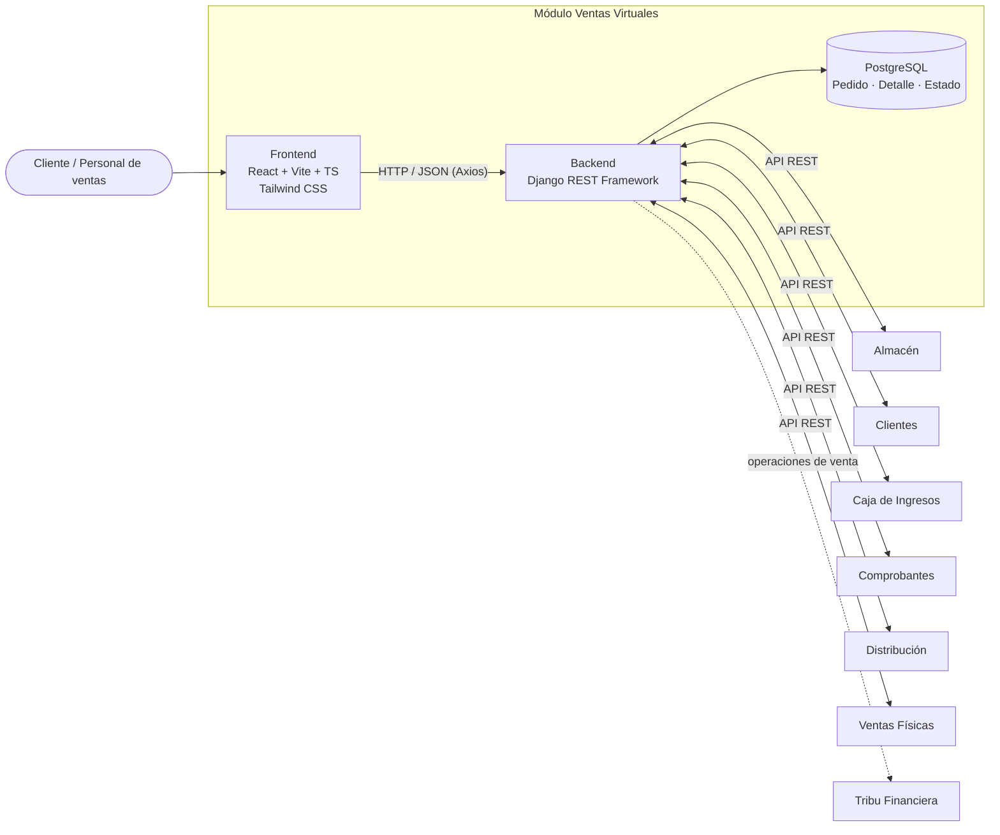
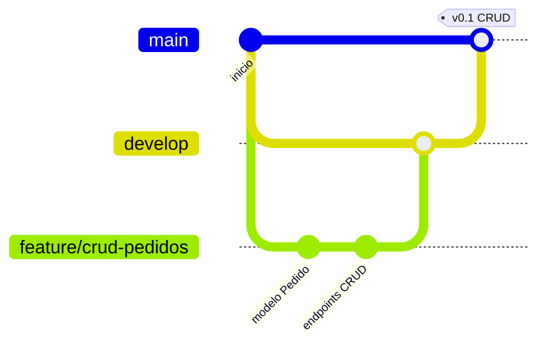

# Ventas Virtuales · ERP Académico

> Módulo de **Ventas Virtuales** de la **Tribu Ingresos** del ERP académico.
> Gestiona los pedidos realizados por canal digital: desde la consulta del catálogo hasta el seguimiento del pedido, integrándose con los demás módulos del ERP sin duplicar sus funciones.

| | |
|---|---|
| **Universidad** | Universidad Nacional de San Agustín de Arequipa |
| **Escuela** | Ingeniería de Sistemas · Facultad de Ingeniería de Producción y Servicios |
| **Asignatura** | Fundamentos de Sistemas de Información · Grupo B · 2026-B |
| **Docente** | Juarez Bueno Juan Carlos |
| **Metodología** | Scrum |

---

## Contenido
1. [Objetivo](#objetivo)
2. [Alcance del MVP](#alcance-del-mvp)
3. [Arquitectura](#arquitectura)
4. [Stack tecnológico](#stack-tecnológico)
5. [Estructura del repositorio](#estructura-del-repositorio)
6. [Primeros pasos](#primeros-pasos)
7. [Flujo de trabajo](#flujo-de-trabajo)
8. [Equipo y roles](#equipo-y-roles)
9. [Documentación](#documentación)

---

## Objetivo
Analizar, diseñar y construir un **Producto Mínimo Viable (MVP)** de Ventas Virtuales que permita registrar y dar seguimiento a pedidos por internet, coordinando su atención con Almacén, Clientes, Caja de Ingresos, Comprobantes, Distribución y la Tribu Financiera.

## Alcance del MVP

| Incluido | Fuera del alcance (lo resuelven otros módulos o versiones futuras) |
|----------|---------------------------------------------------------------------|
| Consulta de productos (catálogo) | Gestión de inventario y movimientos de stock → **Almacén** |
| Carrito de compras | Confirmación y registro de pagos → **Caja de Ingresos** |
| Registro de pedidos con detalle | Emisión de comprobantes y Registro de Ventas → **Comprobantes** |
| Asociación del pedido con el cliente | Gestión de entregas → **Distribución** |
| Cálculo de subtotales e importe total | Asientos contables → **Tribu Financiera** |
| Consulta y seguimiento del estado del pedido | Pasarelas bancarias reales, promociones, recomendaciones |

Detalle completo en [`docs/alcance.md`](docs/alcance.md) y [`docs/requisitos.md`](docs/requisitos.md).

## Arquitectura



Diagramas de contexto, capas, flujo del pedido, modelo de datos y tablas SUNAT en [`docs/arquitectura.md`](docs/arquitectura.md).

## Stack tecnológico

| Capa | Tecnología | Uso |
|------|------------|-----|
| Frontend | React + Vite + TypeScript | Componentes para catálogo, carrito, formularios y tablas |
| Estilos | Tailwind CSS | Interfaz sencilla y responsive (RNF-01) |
| Consumo de API | Axios | Comunicación con el backend vía REST |
| Backend | Python + Django REST Framework | API REST, validaciones y lógica de pedidos |
| Base de datos | PostgreSQL | Persistencia de pedidos, detalles y estados |
| Prototipado | Figma | Diseño de pantallas antes de programar |
| Pruebas de API | Postman | Verificación de los endpoints del CRUD |
| Versionado | Git + GitHub | Trabajo colaborativo por ramas y Pull Requests |

## Estructura del repositorio

```
ventas-virtuales/
├── backend/            API REST (Django REST Framework)
├── frontend/           Aplicación web (React + Vite + TypeScript + Tailwind)
├── docs/
│   ├── alcance.md          Alcance, MVP, comparación ERP y consultas al docente
│   ├── requisitos.md       RF, RNF e historias de usuario
│   ├── arquitectura.md     Diagramas y modelo de datos
│   ├── integracion.md      Dependencias y acuerdos con otros módulos
│   ├── roles.md            Responsabilidades e indicaciones por rol
│   └── flujo-de-trabajo.md Ramas, commits, Pull Requests y Definition of Done
└── .github/            Plantillas de Pull Request e Issues
```

## Primeros pasos

```bash
git clone https://github.com/unsa-fsi-2026b-ventas-virtuales/ventas-virtuales.git
cd ventas-virtuales
git checkout develop
```

- Backend: ver [`backend/README.md`](backend/README.md) (requiere Python 3.10+ y PostgreSQL).
- Frontend: ver [`frontend/README.md`](frontend/README.md) (requiere Node.js 20+).

## Flujo de trabajo



- `main` → versión estable; solo recibe Pull Requests aprobados.
- `develop` → integración del trabajo del sprint.
- `feature/*`, `fix/*`, `docs/*` → ramas de trabajo creadas desde `develop`.

Convenciones completas en [`docs/flujo-de-trabajo.md`](docs/flujo-de-trabajo.md).

## Equipo y roles

| Integrante | Rol | Responsabilidad principal |
|------------|-----|---------------------------|
| Ponce Llerena Renato Xavier | **Product Owner** | Visión, alcance y prioridades del Product Backlog; valida el diccionario de datos y el MVP |
| Mayta Quispe Paola Adamari | **Scrum Master** | Facilita la coordinación, el tablero, las actas y la remoción de impedimentos |
| Bedregal Coaguila Karla Miluska | **DevOps y Arquitectura** | Estructura del monorepo, entornos, integración con el ERP y diccionario de datos |
| Llaique Chullunquia Jack Franco | **Backend** | Servicios de pedidos, detalle y estados; contratos de intercambio (API REST) |
| Chavez Cuno Deivick Paul Eddi | **Frontend** | Prototipos y pantallas de catálogo, carrito, registro y consulta de pedidos |
| Soria Soncco Rodolfo | **QA** | Casos de prueba de pedido, stock, totales, validaciones y cambios de estado |
| Huaynacho Mango Jerry Anderson | **BI** | Indicadores de pedidos y ventas virtuales; administración del repositorio |
| Quispe Mamani Jose Gabriel | **Patrones de diseño / Referencia ERP** | Patrones de objeto y comparación con flujos de Odoo / SAP Business One |

**Subgrupos de trabajo**

| Subgrupo | Integrantes | Entrega inicial |
|----------|-------------|-----------------|
| Producto e investigación | Renato, José Gabriel, Jerry | Alcance, comparación ERP, indicadores y consultas al docente |
| Experiencia y diseño | Deivick, Jack | Prototipo de flujo y propuesta de entidades / transacciones |
| Integración y calidad | Karla, Rodolfo | Dependencias técnicas, riesgos y casos de prueba |
| Coordinación transversal | Paola | Tablero, actas, bloqueos y consolidación |

Indicaciones detalladas para cada rol en [`docs/roles.md`](docs/roles.md).

## Documentación

| Documento | Contenido |
|-----------|-----------|
| [Alcance](docs/alcance.md) | Descripción, MVP, comparación con SAP B1 / Odoo, consultas al docente |
| [Requisitos](docs/requisitos.md) | RF-01…RF-10, RNF-01…RNF-06, HU-01…HU-07 |
| [Arquitectura](docs/arquitectura.md) | Contexto, capas, flujo del pedido, modelo de datos, tablas SUNAT |
| [Integración](docs/integracion.md) | Dependencias con otros módulos y acuerdos pendientes |
| [Roles](docs/roles.md) | Responsabilidades, entregables e indicaciones por rol |
| [Flujo de trabajo](docs/flujo-de-trabajo.md) | Ramas, commits, Pull Requests y Definition of Done |

---

<sub>Proyecto académico · UNSA · Fundamentos de Sistemas de Información · 2026-B</sub>
