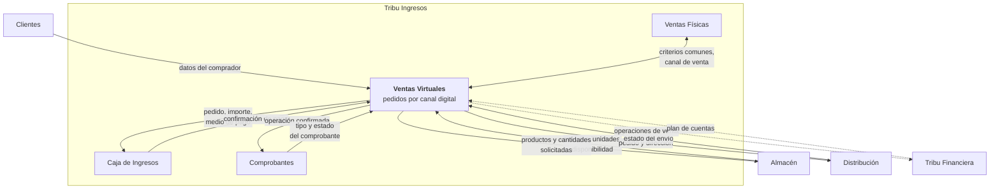
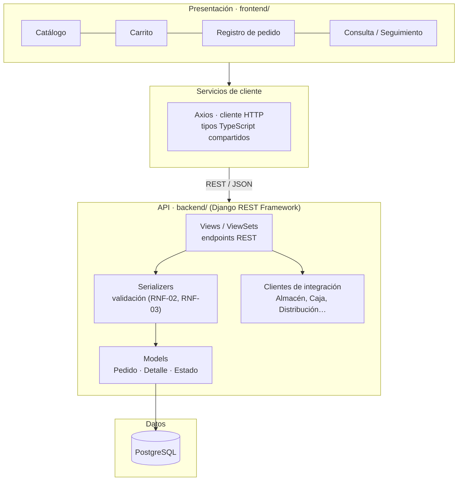
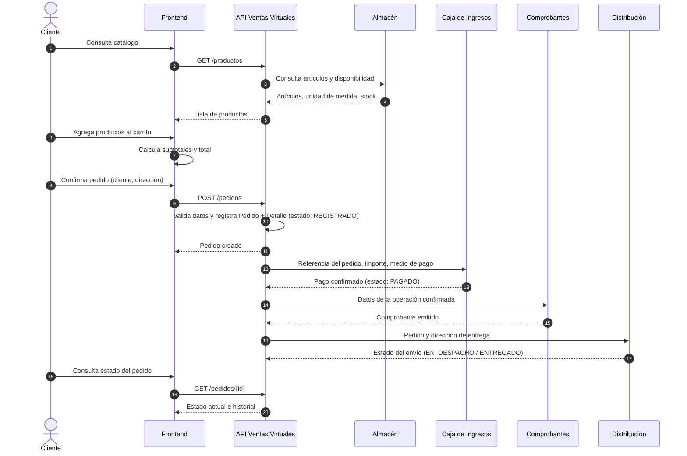
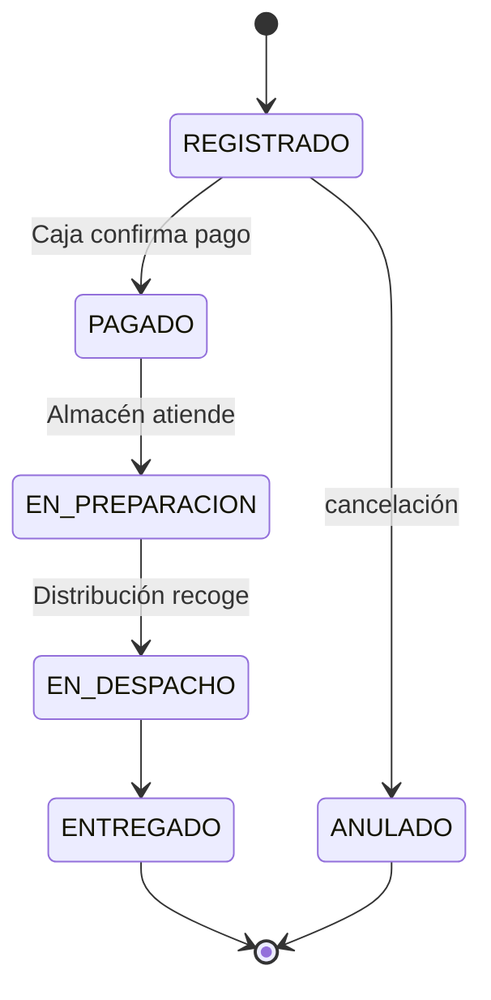
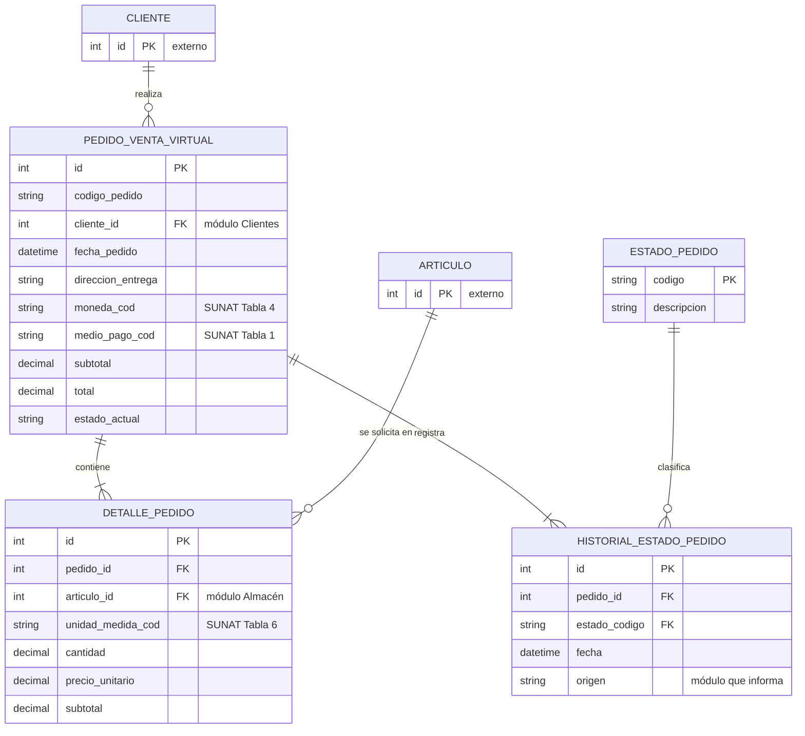

# Arquitectura

Propuesta de arquitectura del módulo de Ventas Virtuales. Está sujeta a los estándares que se definan para todo el ERP y a los acuerdos con los demás módulos.

## 1. Contexto del módulo dentro del ERP

Ventas Virtuales **gestiona el pedido virtual y coordina su atención**; no reimplementa inventario, cobros, comprobantes ni distribución.

## 2. Arquitectura por capas

| Capa | Responsabilidad | Tecnología |
|------|-----------------|------------|
| Presentación | Pantallas, estado del carrito (hooks), formularios y tablas | React + Vite + TypeScript + Tailwind CSS |
| Servicios de cliente | Llamadas HTTP y tipado de las respuestas | Axios |
| API | Endpoints, validaciones, reglas de negocio, autorización (RNF-04) | Django REST Framework |
| Integración | Consumo de las APIs de otros módulos según contratos acordados (RNF-05) | DRF / `requests` |
| Datos | Persistencia de los registros propios del módulo | PostgreSQL |

## 3. Flujo del pedido virtual

> El orden definitivo de pago, comprobante y despacho se establecerá por acuerdo entre los módulos.

## 4. Estados del pedido (propuesta)

## 5. Modelo de datos (propuesta)

Registros **propios** del módulo: pedido, detalle y estado. Clientes, artículos y catálogos SUNAT se **referencian** por su identificador, no se duplican.

> Los nombres definitivos de tablas y campos los fija el **diccionario de datos** validado por el Product Owner.

## 6. Tablas comunes (SUNAT) identificadas

| Tabla | Uso propuesto | Tipo de uso |
|-------|---------------|-------------|
| Tabla 1 · Tipo de medio de pago | Medio de pago seleccionado | Directo |
| Tabla 2 · Tipo de documento de identidad | Identificación del comprador | Vía Clientes |
| Tabla 3 · Entidad financiera | Bancos cuando corresponda | Vía Caja |
| Tabla 4 · Tipo de moneda | Moneda de la operación | Directo |
| Tabla 5 · Tipo de existencia | Consulta indirecta | Vía Almacén |
| Tabla 6 · Código de unidad de medida | Unidades de los artículos | Directo |
| Tabla 10 · Tipo de comprobante | Relación venta–comprobante | Vía Comprobantes |
| Tabla 12 · Tipo de operación | Por verificar | Pendiente |
| Tabla 13 · Catálogo de existencias | Por coordinar | Vía Almacén |
| Tabla 17 · Plan de cuentas | Integración contable | Vía Tribu Financiera |

## 7. API REST inicial (borrador para el CRUD)

| Método | Endpoint | Descripción | RF |
|--------|----------|-------------|----|
| GET | `/api/productos/` | Lista de artículos disponibles | RF-01, RF-09 |
| GET | `/api/pedidos/` | Lista de pedidos (filtros por estado, fecha, cliente) | RF-07 |
| POST | `/api/pedidos/` | Registra pedido con su detalle | RF-04, RF-05, RF-06 |
| GET | `/api/pedidos/{id}/` | Consulta un pedido y su detalle | RF-07 |
| PUT/PATCH | `/api/pedidos/{id}/` | Actualiza un pedido en estado REGISTRADO | RF-06 |
| DELETE | `/api/pedidos/{id}/` | Anula el pedido (cambio de estado, no borrado físico) | RF-06 |
| GET | `/api/pedidos/{id}/estados/` | Historial de estados | RF-08 |
| POST | `/api/pedidos/{id}/estados/` | Registra un cambio de estado informado por otro módulo | RF-10 |
