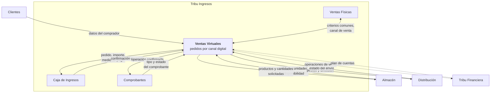
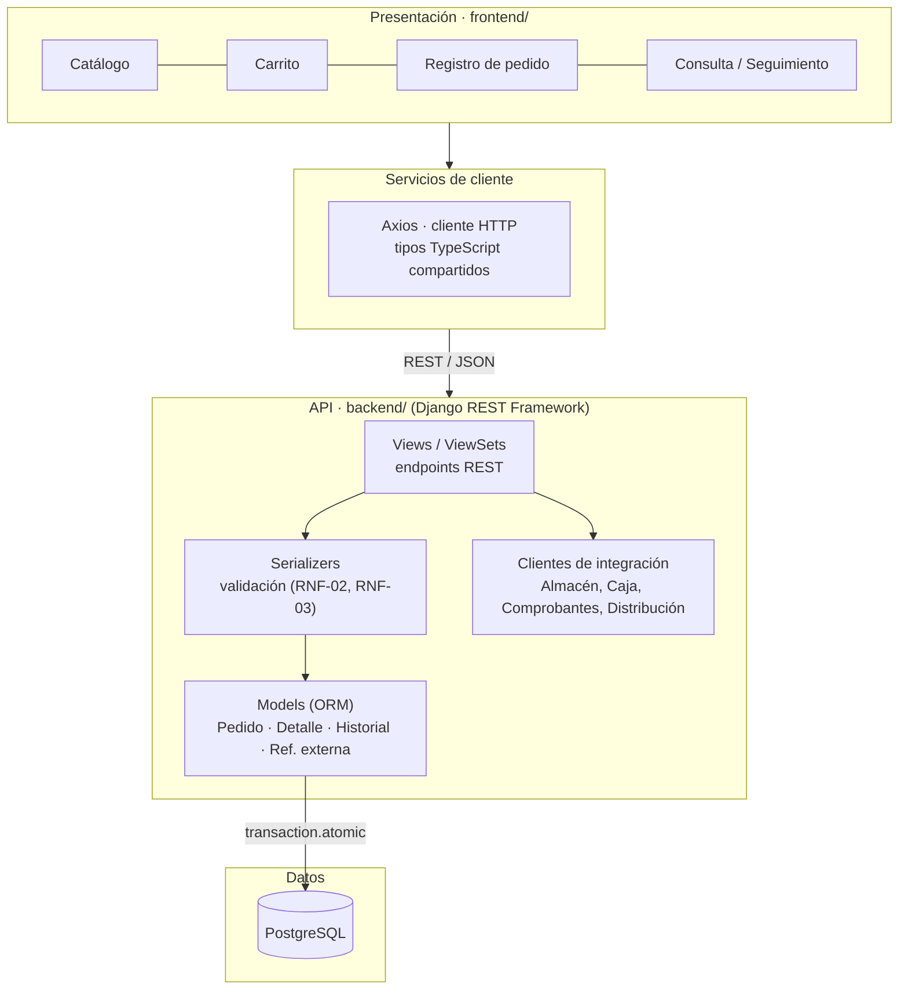
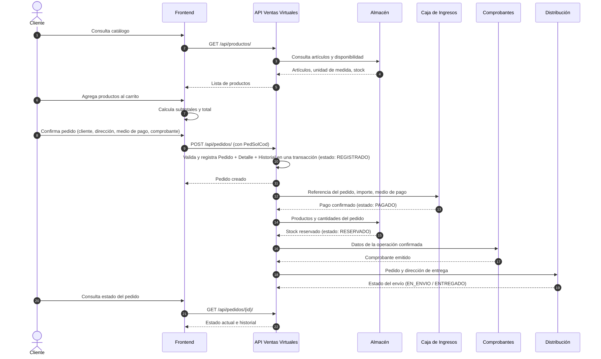
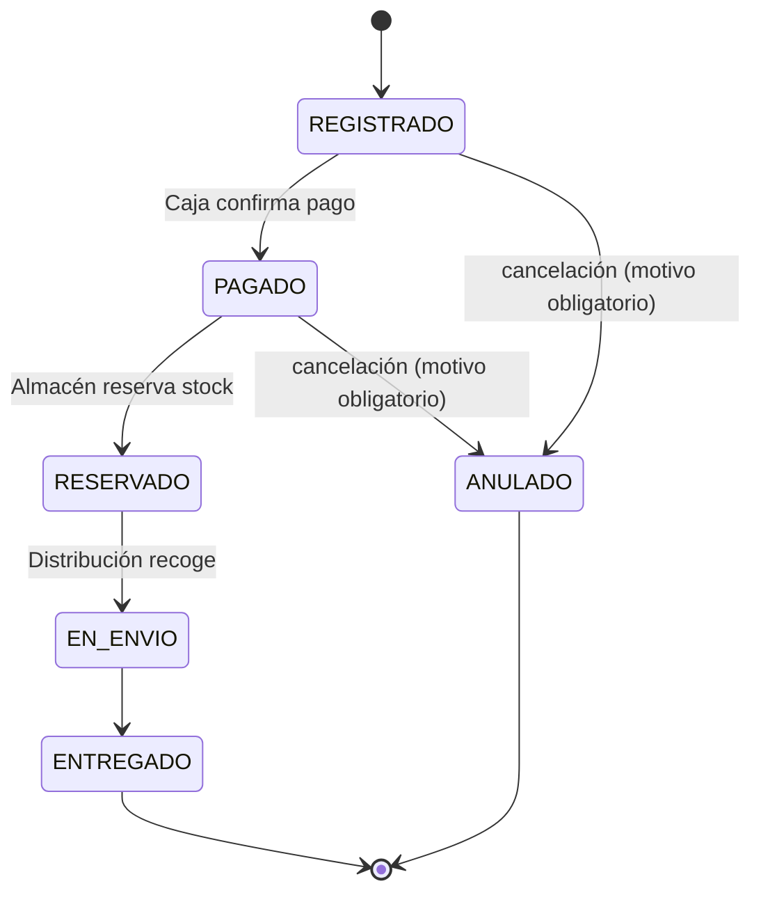
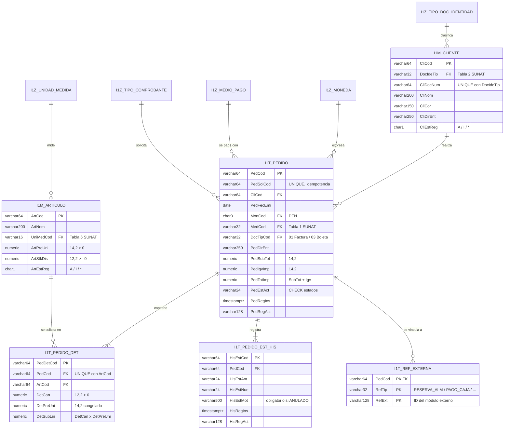

# Arquitectura

Propuesta de arquitectura del módulo de Ventas Virtuales. Está sujeta a los estándares que se definan para todo el ERP y a los acuerdos con los demás módulos. Los nombres de tablas, campos y reglas siguen el **diccionario de datos** del módulo ([`diccionario-de-datos.xlsx`](diccionario-de-datos.xlsx)).

## 1. Contexto del módulo dentro del ERP

Ventas Virtuales **gestiona el pedido virtual y coordina su atención**; no reimplementa inventario, cobros, comprobantes ni distribución.

## 2. Arquitectura por capas

| Capa | Responsabilidad | Tecnología |
|------|-----------------|------------|
| Presentación | Pantallas, estado del carrito (hooks), formularios y tablas | React + Vite + TypeScript + Tailwind CSS |
| Servicios de cliente | Llamadas HTTP y tipado de las respuestas | Axios |
| API | Endpoints, validaciones, reglas de negocio, autorización (RNF-04) | Django REST Framework |
| Integración | Consumo de las APIs de otros módulos según contratos acordados (RNF-05) | DRF / `requests` |
| Datos | Persistencia de los registros propios del módulo | PostgreSQL (ORM de Django con migraciones) |

El backend es la única capa que accede a la base de datos. Los recursos de otros módulos no se copian: solo se guarda su identificador en `I1T_REF_EXTERNA`.

## 3. Flujo del pedido virtual

> El orden definitivo de pago, reserva, comprobante y despacho se establecerá por acuerdo entre los módulos. Cada respuesta externa se guarda en `I1T_REF_EXTERNA` (`RESERVA_ALM`, `PAGO_CAJA`, `COMPROBANTE`, `ENVIO_DIST`, `ASIENTO_FIN`).

## 4. Estados del pedido

Estados definidos en el diccionario (`PedEstAct`, controlado con CHECK). Cada cambio genera un registro en `I1T_PEDIDO_EST_HIS`.

## 5. Modelo de datos

Registros **propios** del módulo (`I1T_*`): pedido, detalle, historial de estados y referencias externas. Clientes y artículos (`I1M_*`) son compartidos con los módulos Clientes y Almacén. Los catálogos SUNAT (`I1Z_*`) son referenciales. Las claves son códigos de texto estables, no autoincrementales.

### Restricciones principales (se declaran en `Meta.constraints` y Django las crea en PostgreSQL)

| Regla | Restricción |
|-------|-------------|
| RE_PedAltaIdem | `UNIQUE (PedSolCod)` |
| RE_DetUnicoArt | `UNIQUE (PedCod, ArtCod)` |
| RE_CliIdUni | `UNIQUE (DocIdeTip, CliDocNum)` |
| RE_PedTotCuadre | `CHECK (PedTotImp = PedSubTot + PedIgvImp)` |
| RE_DetSubCalc | `CHECK (DetSubLin = DetCan * DetPreUni)` |
| RE_DetCanPos / RE_ArtStkVal | `CHECK (DetCan > 0)`, `CHECK (ArtStkDis >= 0)` |
| RE_PedEstDom | `CHECK (PedEstAct IN ('REGISTRADO','PAGADO','RESERVADO','EN_ENVIO','ENTREGADO','ANULADO'))` |
| RE_HisAnul | `CHECK (HisEstNue <> 'ANULADO' OR HisEstMot <> '')` |
| RE_PedAltaAtom | Cabecera, detalle e historial inicial en un solo `transaction.atomic` |

Las reglas que dependen de otros módulos (stock en Almacén, Factura con RUC) se validan en el backend dentro de la transacción.

## 6. Tablas comunes (SUNAT)

| Tabla SUNAT | Tabla del módulo | Uso | Tipo de uso |
|-------------|------------------|-----|-------------|
| Tabla 1 · Tipo de medio de pago | `I1Z_MEDIO_PAGO` | Medio de pago del pedido | Directo |
| Tabla 2 · Tipo de documento de identidad | `I1Z_TIPO_DOC_IDENTIDAD` | Identificación del comprador | Directo |
| Tabla 3 · Entidad financiera | — | Bancos cuando corresponda | Vía Caja |
| Tabla 4 · Tipo de moneda | `I1Z_MONEDA` | Moneda del pedido (PEN) | Directo |
| Tabla 5 · Tipo de existencia | — | Consulta indirecta | Vía Almacén |
| Tabla 6 · Código de unidad de medida | `I1Z_UNIDAD_MEDIDA` | Unidad de los artículos | Directo |
| Tabla 10 · Tipo de comprobante | `I1Z_TIPO_COMPROBANTE` | Boleta (03) o Factura (01) solicitada | Directo |
| Tabla 12 · Tipo de operación | — | Por verificar | Pendiente |
| Tabla 13 · Catálogo de existencias | `I1M_ARTICULO` | Catálogo de la tienda virtual | Compartido con Almacén |
| Tabla 17 · Plan de cuentas | — | Integración contable | Vía Tribu Financiera |

## 7. API REST inicial (borrador para el CRUD)

| Método | Endpoint | Descripción | RF |
|--------|----------|-------------|----|
| GET | `/api/productos/` | Lista de artículos disponibles | RF-01, RF-09 |
| GET | `/api/pedidos/` | Lista de pedidos (filtros por estado, fecha, cliente) | RF-07 |
| POST | `/api/pedidos/` | Registra pedido con su detalle; `PedSolCod` evita duplicados | RF-04, RF-05, RF-06 |
| GET | `/api/pedidos/{id}/` | Consulta un pedido y su detalle | RF-07 |
| PUT/PATCH | `/api/pedidos/{id}/` | Actualiza un pedido en estado REGISTRADO | RF-06 |
| DELETE | `/api/pedidos/{id}/` | Anula el pedido (cambio a ANULADO con motivo obligatorio, no borrado físico) | RF-06 |
| GET | `/api/pedidos/{id}/estados/` | Historial de estados | RF-08 |
| POST | `/api/pedidos/{id}/estados/` | Registra un cambio de estado informado por otro módulo | RF-10 |

La documentación de los endpoints se genera con **drf-spectacular** (Swagger UI).

## 8. Decisión de tecnologías

La comparación completa de alternativas está en el documento *Arquitectura del módulo — Comparación de tecnologías y decisión del equipo*.

| Componente | Tecnología |
|------------|------------|
| Base de datos | PostgreSQL |
| Backend | Python + Django REST Framework |
| Acceso a datos | ORM de Django con migraciones (`Meta.db_table` y `db_column` con los nombres del diccionario) |
| Scripts SQL | `01_estructura.sql` generado con `sqlmigrate`; `02_datos_prueba.sql` escrito aparte |
| Documentación de servicios | drf-spectacular (Swagger) |
| Frontend | React + Vite + TypeScript, Tailwind CSS, Axios |
| Pruebas | pytest, pytest-django y Postman |
